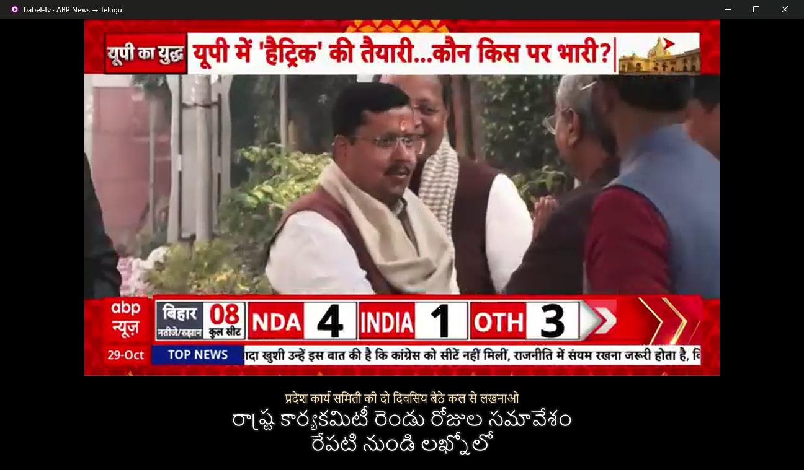

# babel-tv

**Watch any public TV channel in the world with live subtitles in your language, fully local.**

```bash
babel-tv play "ABP News" --language hi --to te      # Hindi news, Telugu subtitles
babel-tv pick --language es --to te                 # probe Spanish channels, pick one
```



*ABP News, live, 2026-10-29. Hindi speech → whisper → gemma-4-12b → Telugu, drawn under
the picture so the channel's own tickers stay readable. The small line is what whisper heard.*

babel-tv reads the [iptv-org](https://github.com/iptv-org/iptv) directory of publicly
available streams, picks a channel that is actually live, and runs its audio through
VAD chunking, faster-whisper and a local LLM on your own GPU. Then it plays the channel in
mpv, held back a few seconds so the translated subtitles arrive *before* the speech
does. Nothing leaves your machine except the stream request itself.

Telugu and Hindi are the hero languages. Every other tool in this space translates into
English or Chinese (see [docs/competition.md](docs/competition.md)).

## Status: v0, honest version

| | |
|---|---|
| Hindi → Telugu, live, in mpv | **Works.** Subtitles ready 1.4 s after speech (median), 0 late cues in 4 runs on a 5 s delay |
| Spanish → Telugu | **Works**, after a whisper-loop fix (below) |
| Telugu → Hindi (Telugu as the *source*) | **Does not work yet.** Whisper can't transcribe Telugu TV reliably, offline either |
| Japanese | Untested with speech: the live Japanese channels were playing music during testing |
| Dubbing | **Not done.** The local Qwen3-TTS has no Telugu or Hindi voice (it speaks en zh de it pt es ja ko fr ru) |
| Picture delay held at exactly 5 s | **Mostly.** HLS underruns push it up; a 1.1× catch-up pulls it back (median 6.6 s) |

## Install

Needs ffmpeg and mpv on the machine, plus an OpenAI-compatible LLM server (llama-server).

```bash
winget install mpv-player.mpv-CI.MSVC        # or: brew install mpv / apt install mpv
python -m venv .venv && .venv/Scripts/pip install -e .
export LLAMA_API_KEY=...                     # if your llama-server uses --api-key
```

Defaults: whisper `large-v3-turbo` (int8_float16, CUDA; falls back to CPU int8) and
translation model `gemma-4-12b` at `http://127.0.0.1:8080`. Change them with `--asr-model`,
`--model`, `--server` (or `BABEL_TV_MODEL`, `BABEL_TV_SERVER`). Reasoning is turned off
per request (`chat_template_kwargs.enable_thinking=false`). Left on, gemma-4 and qwen
think by default, and that alone is about 8× the latency.

## Use

```bash
babel-tv channels --language te --probe              # live Telugu channels (30/40 were up)
babel-tv channels --country in --language hi --group news
babel-tv pick --country in --language hi --to te     # numbered list of live streams, then play
babel-tv play "DW Espanol" --language es --to te --delay 6
babel-tv play https://example.com/stream.m3u8 --from ja --to hi
babel-tv play "ABP News" --language hi --to te --no-player --duration 120   # headless + metrics
```

Every run writes `subs.srt` (translated), `source.srt` (what whisper heard), `cues.jsonl`
(per-cue timings) and `summary.json` to `runs/<timestamp>/`. Add `--save-audio` to keep
the audio for `scripts/quality.py`.

`--language` does two jobs. It picks the iptv-org list, and it tells whisper what
language to expect (`--from` overrides it). That second job matters: see Telugu below.

## How it works

```
iptv-org m3u ─ probe (ffprobe, 16 parallel) ─▶ live channel
                                                  │
ffmpeg ─┬─ PCM 16 kHz ─▶ silero VAD ─▶ chunker ─▶ whisper ─▶ LLM ─▶ cue track
        │                (32 ms frames)  (≤3 s,     (beam 1,  (2 lines  │
        │                                 cut at     prompt =  context)  │
        │                                 quietest   last 200            │
        │                                 frame)     chars)              │
        └─ MPEG-TS copy ─▶ TCP relay ─▶ mpv (cache-pause-wait = delay) ◀─┘ osd-overlay via IPC,
                                                                          keyed on mpv time-pos
```

- **Chunker** (`babel_tv/chunker.py`). Closes a chunk on a 350 ms pause. If someone talks
  without pausing (news anchors do), it force-cuts at 3 s, at the *quietest* frame of the
  last 0.8 s, so the cut lands between words, not inside one.
- **Delay**. mpv itself buffers `--delay` seconds before playing, so the translator gets
  that head start. Subtitles are drawn by polling mpv's `time-pos`, so they stay locked
  to the picture through stalls.
- **Catch-up**. When the picture drifts 1.5 s past the target delay, mpv plays at 1.1×
  until it is back.
- **Whisper guards**. A blocklist for credit-roll hallucinations ("ご視聴ありがとうございました",
  "thanks for watching"), a compression-ratio check, and a repeat guard (below).

## Measurements

All numbers are from live public streams on 2026-10-29, on an RTX 5080 shared with a
llama-server that other jobs were also using. Raw data is in `runs/` (gitignored).

### Latency

*lag* is how long after a stall-free live player shows the speech that the subtitle is
ready. It is the extra delay babel-tv needs. ≤ 0 means early. *Late* counts cues not
ready within the 5 s delay.

| Run | Length | Cues | ASR | MT | Processing | Lag p95 | Lag max | Late |
|---|---:|---:|---:|---:|---:|---:|---:|---:|
| ABP News hi→te, mpv | 75 s | 28 | 0.41 s | 1.06 s | 1.48 s | 1.41 s | 2.77 s | 0 |
| ABP News hi→te, mpv + catch-up | 120 s | 35 | 0.38 s | 0.88 s | 1.39 s | 0.03 s | 1.51 s | 0 |
| ABP News hi→te, headless | 150 s | 59 | 0.38 s | 1.00 s | 1.38 s | 1.48 s | 2.16 s | 0 |
| ETV News te→hi, headless | 150 s | 16 | 1.25 s | 0.61 s | 1.69 s | 1.88 s | 1.88 s | 0 |
| DW Espanol es→te, headless | 150 s | 36 | 0.31 s | 0.98 s | 1.38 s | 11.35 s | 12.44 s | **4** |

The 4 late DW cues are all in one 15-second window (118–133 s), where the translation
call took 8–13 s instead of about 1 s. The ASR stayed at 0.3 s. Two other models were
loaded on the same llama-server by other jobs at the time. So this is shared-server
contention, not the pipeline, but it is what you would see on a busy box.

Raw "first sample arrived → subtitle ready" (e2e) has a median of 2–3 s but a p95 of 8–14 s.
That is HLS, not compute: audio arrives in 2–6 s segment bursts, so the first word of a
burst waits for the rest of it. That is why the lag metric above is measured against a
player clock.

**Picture delay** (how far behind live the picture really runs, `--delay 5`):

| Run | Median | p95 |
|---|---:|---:|
| First mpv run | 5.2 s | |
| Without catch-up | 15.2 s | |
| With catch-up | 6.6 s | 10.3 s |

mpv re-buffers the full delay after each HLS underrun, so without catch-up the delay
creeps up. Catch-up holds it near the target, but it spent 58 of 120 s at 1.1×.

### Transcription quality

There is no human transcript of live TV. So `scripts/quality.py` measures what *live
chunking* costs. It re-transcribes the same saved audio offline with full context (whisper
large-v3, beam 5, word timestamps) and compares each live cue with the offline words in
the same time span. This is live vs offline whisper, **not accuracy against a human**.

| Run | Aligned CER | Coverage | Unmatched live text |
|---|---:|---:|---:|
| ABP News hi | 0.40 | 94% | 17% |
| DW Espanol es, before repeat guard | 0.30 | 41% | 21% |
| DW Espanol es, with repeat guard | 0.31 | 66% | 2% |
| ETV News te (forced `te`) | 0.66 | 17% | 76% |

*Coverage* is the share of offline speech that falls inside some live cue. *Unmatched*
is live text where offline whisper heard nothing (hallucinations, or offline misses).

What the numbers say, read alongside the transcripts:

- **Hindi is good enough to follow the news.** CER 0.40 is mostly spelling variation
  (गंटे/घंटे, पे/पर) and chunk-edge words. The meaning survives.
- **The repeat guard mattered.** Before it, DW's live transcript read "...la relación."
  sixteen times in a row. Whisper copies its own prompt during music, and the
  `initial_prompt` keeps feeding it back. Dropping a chunk that repeats one of the last
  three, and clearing the prompt when that happens, took unmatched text from 21% to 2%.
- **Telugu as a source is broken.** With auto-detect, whisper never chose Telugu. It
  wrote Telugu speech in Latin script and labelled it en/pt/ro/ta/tr ("Adivarum Rathri
  90 Guntalakku" is ఆదివారం రాత్రి … గంటలకు, "Sunday night at … o'clock"). Forcing `te`, which `--language te` now does,
  gives Telugu script but garbled words. The *offline* large-v3 reference is just as
  bad and loops. Whisper isn't good enough at Telugu TV speech. A dedicated Indic ASR
  model is the fix (see next steps).

### Translation (my own reading, not a benchmark)

I read the first 14 cues of each run against the source.

- **Hindi → Telugu**: 10/14 faithful and natural ("बीजेपी को नकारा जा रहा है" →
  "బీజేపీని తిరస్కరిస్తున్నారు"). Two translator errors: "उत्तर" (north) became
  దక్షిణం (south), and a garbled "पक्षी दलों" (opposition parties) became "the Congress
  party". Two more came from mis-heard Hindi ("आप कैसे हार रहे हैं", "how are you
  losing", heard as "how are you"). Seat counts and place names were kept.
- **Spanish → Telugu**: fluent. The "..." of mid-sentence cuts carried through.
- **Telugu → Hindi**: garbage in, garbage out. The translator mostly transliterates
  the garbled Telugu. Only fragments ("ETV News", "district", "harvest") survive, and it once invented
  a time ("7 pm") that was never said.

## Tests

```bash
.venv/Scripts/python -m pytest -q     # 43 tests, no network or GPU needed
```

These cover the chunker (pause close, padding, forced cuts at the quietest frame,
hysteresis, streaming == one-shot, bounded memory, ragged byte input), subtitle timing
(reading-time display, capping by the next cue, wrapping, SRT), M3U parsing (quoted commas
in user agents, `#EXTVLCOPT` headers, geo-block tags), the translator's prompt and
cleanup, the HLS burst clock, the repeat guard, catch-up hysteresis, and the
language-hint plumbing.

## Limitations

- Only publicly listed streams from iptv-org. Many are geo-blocked or dead; `--probe`
  and `pick` skip those. Streams come and go: ABP's probe timed out once during testing.
- About 5 s behind live by design. Sports with a second screen will spoil.
- One speaker's words at a time: no diarization, no speaker labels.
- The translator sees two lines of context. It does not know the show or the names
  in it.
- Windows was the test platform. The mpv IPC has a Unix socket path, but it is untested.

## Next steps

- Indic ASR for Telugu (and Tamil, Kannada, Malayalam) as a *source*: AI4Bharat
  IndicConformer, or a Telugu-finetuned whisper converted to CTranslate2.
- Fall back to showing the source line when translation misses the delay, instead of
  showing nothing.
- Dubbing: needs a TTS with Telugu and Hindi voices (Indic Parler-TTS, or IndicF5).

## License

[AGPL-3.0](LICENSE). Self-hosting is free; if you run a modified version as a service, share your changes.
